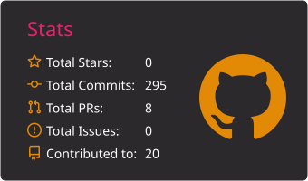
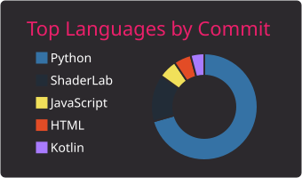
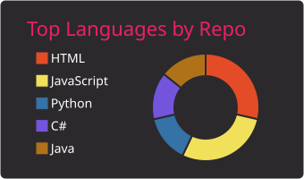

  
  
  

  
  

---

## 🧩 TL;DR

Je suis **Nana Talom Franck Jaures**, **élève-ingénieur en 5e année à l'ENSIM** (École Nationale Supérieure d'Ingénieurs du Mans, option IPS), après deux ans de classes préparatoires scientifiques (MPSI-MP).

Je cherche un **stage de fin d'études de 6 mois à partir de mars 2027**, en priorité en **Data** (analyse, BI, data engineering, machine learning), puis en **Développement**. Mobile dans toute la France.

Je travaille sur toute la chaîne data : **collecte automatisée, bases de données, modélisation, tableaux de bord**.

---

## 🧠 Spécialisations & Apprentissage

* **Data Science & ML** : analyse exploratoire, modèles prédictifs (Python, pandas, scikit-learn, XGBoost), deep learning et NLP (Keras, PyTorch, FinBERT).
* **Data Engineering & BI** : collecte et traitement de données, SQL, PostgreSQL / Supabase, automatisation avec GitHub Actions, tableaux de bord (Power BI, Dash, Streamlit).
* **Développement** : API REST (Spring Boot, Django), applications web (Angular, React), applications Android (Kotlin), conteneurisation avec Docker.
* **Réalité Virtuelle** : projets Unity 3D et interactions VR (C#).

---

## 🧰 Tech Stack

### Langages

  
  
  
  
  
  
  
  

### Data & ML

  
  
  
  
  
  

### BI & Bases de données

  
  
  
  
  
  

### Développement & DevOps

  
  
  
  
  
  
  
  
  

---

## 🧪 Projets

### Data, BI & IA

| Projet | Description | Technologies |
| :--- | :--- | :--- |
| **Plateforme d'IA prévisionnelle de valeurs boursières** (projet d'équipe, 4e année) | Prédiction de valeurs boursières présentée dans une application web. Mon rôle : étude financière, collecte et traitement des données, modèles de comparaison. Résultats d'équipe : LSTM à 62 % de précision directionnelle, Transformer à 3,49 $ d'erreur moyenne. | Python, SQL, PostgreSQL / Supabase, GitHub Actions, FinBERT, Keras, PyTorch, Dash |
| **Prédiction de souscription d'assurance auto** | Classification des clients susceptibles de souscrire, et segmentation client pour cibler les campagnes, dans une application web. | Python, XGBoost, pandas, scikit-learn, Streamlit |
| **Dashboard Power BI — pollution et santé publique** | Croisement de la pollution atmosphérique et de la santé publique par ville : carte, courbes temporelles et questions-réponses. | Power BI (modélisation en étoile) |
| **Portfolio Business Intelligence** | Série de projets data (un dépôt par projet) : KPI, séries temporelles et dashboards interactifs mis à jour automatiquement. | Python, scraping, Power BI, GitHub Actions |

Dépôt du portfolio : [github.com/jaures-BUSINESS-INTELLIGENCE](https://github.com/jaures-BUSINESS-INTELLIGENCE)

### Développement, Mobile & VR

| Projet | Description | Technologies |
| :--- | :--- | :--- |
| **PC Advisor** (binôme) | Recommandation d'ordinateurs : questionnaire en 5 étapes qui propose jusqu'à 3 machines selon le budget, le CPU/GPU et la RAM. | Angular, TypeScript |
| **Application Android d'entraînements** | Application mobile, de la conception au développement : maquettes Figma et prototype basse fidélité réalisés avant le code. | Kotlin, Android (Room, Navigation), Figma |
| **Chatbot Telegram météo & blagues** | API REST pilotant un bot Telegram, avec gestion CRUD. | Java, Spring Boot, OpenAPI / Swagger |
| **MyENSIM** | Plateforme numérique pour la vie étudiante. | Django, Angular, Docker |
| **Site compétition foot** | Gestion de tournois et de matchs de football. | PHP, MySQL, HTML/CSS |
| **Expérience VR immersive** | Configuration du casque VR et finalisation des interactions 3D. | Unity, C#, ShaderLab |

---

## 💼 Expérience

* **Stagiaire — Brasseries du Cameroun** (étés 2023 et 2024) : collecte, nettoyage et analyse de données (production, ventes, filière agricole), tableaux de bord Power BI (TRS, stocks, volumes), traçabilité des matières premières.
* **Hackathon 24h du Code — Le Mans** (défi Covéa) : application en équipe, backend Node.js / Express / RabbitMQ connecté à un frontend React.

---

## 📈 GitHub Telemetry

  
  
  

---

## 🔗 Contact

* **LinkedIn** : [Franck Talom](https://www.linkedin.com/in/franck-jaures-talom-1017b92ab)
* **Email** : [talomjaures@icloud.com](mailto:talomjaures@icloud.com)
* **GitHub** : [github.com/jauresfranck](https://github.com/jauresfranck/)
